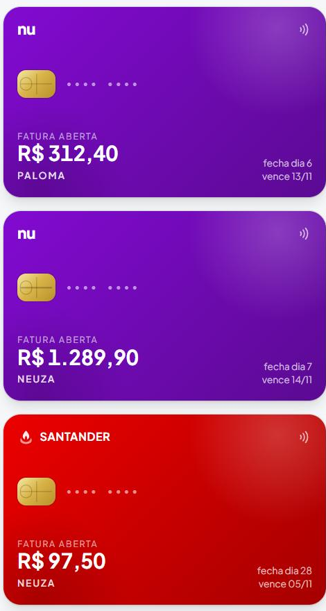

<div align="center">

# Minha Rotina

### Sua vida inteira em um só lugar: tarefas, hábitos, foco, dinheiro e ideias.

[](https://dashboard-three-khaki-68.vercel.app/)
[](#-o-bot-do-telegram)


</div>

---

Um app para as tarefas, outro para os hábitos, uma planilha para os gastos e as ideias
perdidas num bloco de notas. O **Minha Rotina** junta tudo isso numa tela só. Você abre
de manhã e vê o seu dia inteiro: o que falta fazer, quais hábitos já marcou, quanto gastou,
quanto o cartão já deve e quais contas vencem esta semana.

<div align="center">

### Veja funcionando

Marcar um hábito, concluir uma tarefa, buscar com `Ctrl + K`, ver os avisos de contas, ligar o Pomodoro e trocar para o tema escuro:


</div>

> "Não andeis ansiosos pelo dia de amanhã, pois o amanhã cuidará de si mesmo." (Mateus 6:34)

---

## Por que usar

|  |  |
|---|---|
| 🧩 **Tudo em um só lugar** | Rotina e finanças lado a lado, na mesma conta, com a mesma cara. |
| ⚡ **Um gasto em 5 segundos** | Mande *"gastei 50 de gasolina no cartão neuza nubank"* no Telegram e ele já cai no cartão certo, na categoria certa. |
| 🔄 **Sempre atualizado** | O que muda no celular aparece no computador ao vivo, sem recarregar a página. |
| 📱 **Celular e computador** | No celular é um app instalável, que abre até sem internet. No monitor é um painel completo. |
| 🔒 **Seus dados são só seus** | Login com a conta Google e regras de banco que não deixam ninguém mais ler nada. |

---

## 💳 Cartões de crédito

<div align="center">

</div>

Comprar no crédito **não tira dinheiro na hora** — e o app trata assim:

- cada cartão aparece com a cor do banco, chip e a fatura que está aberta agora;
- a compra entra na fatura certa pelo **dia do fechamento** (comprou depois dele, já é a fatura do mês que vem);
- a **fatura em aberto aparece junto das contas a pagar**, com o dia do vencimento;
- quando você marca *"paguei a fatura"*, aí sim sai do saldo;
- toque no cartão e veja tudo que entrou naquela fatura.

---

## O que tem dentro

### 🗓️ Rotina

- **Tarefas do dia** separadas por área (Trabalho, Estudos, Saúde, Casa...), com filtro e barra de progresso.
- **Hábitos diários** com sequência de dias 🔥, que zera sozinha se você pula um dia.
- **Sua semana num relance:** quantas tarefas e hábitos em cada dia, com gráfico e navegação pelas semanas.
- **O que eu fiz nesse dia?** Clique num dia e veja tudo: hábitos, tarefas, quanto gastou e recebeu, metas que andaram, focos e notas.
- **Foco do dia:** Pomodoro com os tempos que você escolher, que continua contando quando troca de página.

### 💰 Finanças

- **Anote em um clique:** gasto, entrada ou conta a pagar — e, no gasto, se foi dinheiro, Pix ou um cartão.
- **Saldo de verdade:** diga quanto tem agora e o saldo anda sozinho a partir daí, sem lançar o histórico inteiro.
- **Entradas e gastos do mês**, comparados com o mês passado, e o gráfico de 7 dias, 30 dias ou 3 meses.
- **Gastos por categoria** — Alimentação, Transporte, Moradia, Lazer, Saúde, Assinaturas, Estudos, Roupas — com a categoria adivinhada pelo que você escreve: "mercado" vira Alimentação, "Netflix" vira Assinaturas, "tênis" vira Roupas. As cores passam no teste de daltonismo, no tema claro e no escuro.
- **Contas a pagar** com vencimento, parcelas (3x, 10x...), contas fixas e faturas de cartão, cada uma com a sua etiqueta.
- **Metas do seu jeito:** "ler 6 livros até dezembro" anda de livro em livro; "juntar R$ 30 mil" anda em reais guardados.
- **Olhinho para esconder os valores** quando tiver alguém do lado.

### 🤖 O bot do Telegram

Vincule a conta uma vez, pelo app, e registre conversando:

| Você manda | O que acontece |
|---|---|
| `gastei 30 no mercado` | gasto de R$ 30, categoria Alimentação |
| `gastei 50 de gasolina no cartão neuza nubank` | entra na fatura desse cartão, em Transporte |
| `netflix 45 cartão paloma` | Assinaturas, no cartão da Paloma |
| `recebi 2500 salário` | entrada de R$ 2.500 |
| `/cartoes` | lista seus cartões, com fechamento e vencimento |
| `/cartao nubank` | põe o último gasto nesse cartão |
| `/ultimas` · `/desfazer` | últimas transações · apaga a última que o bot registrou |
| `/ajuda` | tudo que ele entende |

Tem dois cartões com o mesmo nome? Ele registra e pergunta qual é, em vez de chutar.

### 📝 Notas

Um mural de cortiça com post-its coloridos, presos com alfinete, para ideias rápidas e listas.

### ✨ Os detalhes que fazem diferença

- **Busca em tudo** com `Ctrl + K`: tarefas, transações, contas, metas, hábitos, notas e páginas.
- **Sininho de avisos:** contas vencidas ou vencendo, e o que ainda falta hoje.
- **O céu de agora:** o ícone do "Hoje" mostra sol, nuvem, chuva ou lua conforme o clima da sua cidade.
- **Tema claro e escuro** · **Português e inglês** · **Instalável (PWA)**, abre offline e sincroniza depois.

---

## 🛠️ Como é feito

| Camada | Escolha |
|---|---|
| Frontend | React · Vite · TypeScript · Tailwind · shadcn/ui · Recharts |
| Login | Firebase Auth (conta Google) |
| Banco | Cloud Firestore, com cache offline e atualização ao vivo |
| Bot | Funções serverless na Vercel (`api/`) com Firebase Admin |
| Deploy | Vercel |

O app fala direto com o Firebase. O único código de servidor é o do bot. Quem garante que
cada pessoa só alcança os próprios dados são as regras em [`firestore.rules`](firestore.rules).

As regras de dinheiro (em que fatura cai cada compra, quanto já tem nela, o palpite de
categoria) moram em funções puras, testadas uma a uma — e são as **mesmas** para o app e
para o bot, para os dois nunca discordarem.

<details>
<summary><b>🚀 Rodando o projeto</b></summary>

### 1. Requisitos

- Node.js 20+
- Um projeto no [Firebase](https://console.firebase.google.com) com **Authentication → Google** ativado e um **Firestore** criado

### 2. Configuração

```bash
cp .env.example .env
```

Preencha com a config do seu projeto (Console → Project settings → Your apps → Web):

```env
VITE_FIREBASE_API_KEY=
VITE_FIREBASE_AUTH_DOMAIN=
VITE_FIREBASE_PROJECT_ID=
VITE_FIREBASE_STORAGE_BUCKET=
VITE_FIREBASE_MESSAGING_SENDER_ID=
VITE_FIREBASE_APP_ID=
```

Essas chaves são públicas por design: elas identificam o projeto, não autorizam nada.

Publique as regras de `firestore.rules` no console (Firestore Database → Rules) e adicione
seus domínios em Authentication → Settings → Authorized domains.

### 3. Execução

```bash
npm install
npm run dev
```

### 4. Bot do Telegram (opcional)

1. Crie um bot com o [@BotFather](https://t.me/BotFather) e guarde o token.
2. Na Vercel (Settings → Environment Variables), cadastre só no servidor e **sem** o prefixo `VITE_`:
   - `TELEGRAM_BOT_TOKEN`: o token do BotFather;
   - `TELEGRAM_WEBHOOK_SECRET`: um segredo inventado por você (letras, números, `_` e `-`);
   - `FIREBASE_SERVICE_ACCOUNT`: o JSON da conta de serviço do Firebase, numa linha só.
3. Depois do deploy, ligue o bot ao app (uma vez por ambiente):

```bash
TELEGRAM_BOT_TOKEN=... TELEGRAM_WEBHOOK_SECRET=... \
  node scripts/telegram-webhook.mjs https://seu-app.vercel.app
```

4. No app, clique em **Conectar** no card do Telegram, gere o código e mande `/start CODIGO`.

### Outros comandos

```bash
npm test       # testes
npm run lint   # análise estática
npm run build  # build de produção
npm run icones # regenera ícones e telas de abertura a partir de public/logo.svg
```

</details>

<details>
<summary><b>🔒 Segurança</b></summary>

- **Login com Google**, sem senha guardada em lugar nenhum.
- **Isolamento por usuário:** todo dado mora em `users/{uid}`, e as regras do Firestore só liberam o caminho de quem está logado — verificado no servidor a cada leitura e escrita.
- **Telegram vinculado por código temporário:** o bot só grava para quem provou ser dono da conta, e token e conta de serviço nunca vão para o navegador.
- **Sessão persistente**, guardada pelo próprio Firebase.

</details>

<details>
<summary><b>📁 Estrutura</b></summary>

```
src/
├── desktop/           layout de notebook e monitor (menu lateral, páginas e cards)
├── components/        layout do celular, logo, splash e widgets
│   └── financas/      os cartões de crédito e suas faturas
├── pages/             login, Início, Finanças, Rotina/Progresso, Notas, conta
├── lib/
│   ├── firebase.ts    inicialização do Firebase
│   ├── db.ts          leitura e gravação no Firestore
│   ├── aoVivo.ts      dados ao vivo compartilhados entre os cards
│   ├── cartoes.ts     faturas: em que mês cai cada compra, quanto já tem nela
│   ├── categorias.ts  as categorias e o palpite pelo texto (app e bot usam este)
│   ├── metas.ts       metas em quantidade ou dinheiro, com prazo
│   ├── pomodoro.ts    tempos do Pomodoro, iguais no celular e no computador
│   ├── clima.ts       clima de agora (Open-Meteo)
│   ├── dates.ts       "que dia é hoje", no fuso local
│   └── habits.ts      sequência e "feito hoje"
└── contexts/          autenticação e idioma
api/                   bot do Telegram (funções da Vercel)
firestore.rules        regras de segurança
```

</details>

---

<div align="center">

[](https://www.linkedin.com/in/palomagl)
[](https://wa.me/5551998127367)

**Feito para quem quer a vida organizada sem precisar de cinco apps diferentes.**

</div>
